# ApexCommerce: Production Hosting & Server Deployment Guide
### Complete Bare-Metal VPS (Ubuntu/Nginx) & Docker Deployment Manual
> **Special Focus**: Architectural differences between PHP/Laravel deployment (PHP-FPM + Nginx) and .NET deployment (Kestrel + Systemd + Nginx Reverse Proxy).

---

## Table of Contents
- [1. Fundamental Differences: PHP/Laravel Hosting vs .NET Hosting](#1-fundamental-differences-phplaravel-hosting-vs-net-hosting)
- [2. Approach A: Deployment WITHOUT Docker (Bare-Metal / Ubuntu VPS)](#2-approach-a-deployment-without-docker-bare-metal--ubuntu-vps)
  - [Step 1: Install .NET Runtime, PostgreSQL & Redis](#step-1-install-net-runtime-postgresql--redis)
  - [Step 2: Build & Publish Artifacts](#step-2-build--publish-artifacts)
  - [Step 3: Linux Systemd Services (Replacing Laravel Supervisor)](#step-3-linux-systemd-services-replacing-laravel-supervisor)
  - [Step 4: Nginx Reverse Proxy Configuration (With WebSocket Support)](#step-4-nginx-reverse-proxy-configuration-with-websocket-support)
  - [Step 5: SSL Certificate Automation (Certbot)](#step-5-ssl-certificate-automation-certbot)
- [3. Approach B: Deployment WITH Docker & Docker Compose](#3-approach-b-deployment-with-docker--docker-compose)
  - [Production Multi-Container Stack](#production-multi-container-stack)
  - [Zero-Downtime Container Update Script](#zero-downtime-container-update-script)
- [4. Environment Variables: Laravel `.env` vs .NET Configuration](#4-environment-variables-laravel-env-vs-net-configuration)
- [5. Production Database Migrations Strategy](#5-production-database-migrations-strategy)
- [6. Interview Cheat Sheet: .NET Hosting & DevOps](#6-interview-cheat-sheet-net-hosting--devops)

---

## 1. Fundamental Differences: PHP/Laravel Hosting vs .NET Hosting

Laravel এবং .NET-এর হোস্টিং মেকানিজম সম্পূর্ণ ভিন্ন ধারণার ওপর প্রতিষ্ঠিত। একজন সিনিয়র Laravel ব্যাকএন্ড ইঞ্জিনিয়ারের জন্য এই পার্থক্যগুলো বোঝা অত্যন্ত জরুরি:

```mermaid
flowchart TD
    subgraph Laravel_PHP_Hosting["Laravel Hosting (Nginx + FastCGI + PHP-FPM)"]
        L_Client["User Request"] --> L_Nginx["Nginx (Port 80/443)"]
        L_Nginx -->|"FastCGI Protocol (Unix Socket)"| L_FPM["PHP-FPM Worker Pool"]
        L_FPM -->|"Spawns Process, Loads public/index.php"| L_App["Laravel App (Kills process after response)"]
        L_Sup["Supervisor Daemon"] -->|"Keeps worker alive"| L_Q["php artisan queue:work"]
    end

    subgraph DotNet_Hosting["ApexCommerce Hosting (Nginx Reverse Proxy + Kestrel)"]
        D_Client["User Request"] --> D_Nginx["Nginx (Port 80/443 - SSL Termination)"]
        D_Nginx -->|"HTTP Reverse Proxy (http://127.0.0.1:5000)"| D_Kestrel1["Kestrel Web Server (ApexCommerce.Api)"]
        D_Nginx -->|"WebSocket Upgrade (http://127.0.0.1:5001)"| D_Kestrel2["Kestrel Web Server (ApexCommerce.Admin.Blazor)"]
        D_Systemd["Systemd Service Manager"] -->|"Auto-restarts if crashes"| D_Kestrel1
        D_Kestrel1 -->|"In-Memory Threads"| D_Worker["Built-in Channel Background Workers"]
    end
```



### প্রধান পার্থক্যের তুলনামূলক টেবিল:

| বিষয় | Laravel (PHP-FPM) | .NET 9/10 (Kestrel + Systemd) |
| :--- | :--- | :--- |
| **Web Server** | Nginx সরাসরি PHP ফাইল এক্সিকিউট করতে পারে না; তাই **FastCGI** দিয়ে PHP-FPM পুলে পাঠায়। | .NET-এর নিজস্ব অত্যন্ত দ্রুতগামী বিল্ট-ইন ওয়েব সার্ভার রয়েছে: **Kestrel**। |
| **Nginx-এর ভূমিকা** | Nginx নিজেই রুট ডিরেক্টরি (`/var/www/public`) চেনে এবং স্ট্যাটিক ফাইল দেয়। | Nginx এখানে **Reverse Proxy** হিসেবে কাজ করে। Nginx SSL হ্যান্ডেল করে রিকোয়েস্ট লোকাল পোর্টে Kestrel-এ ফরোয়ার্ড করে। |
| **প্রসেস লাইফসাইকেল** | **Short-Lived (Per Request)**: প্রতিটি রিকোয়েস্টে ফাইল রিড করে প্রসেস তৈরি হয় এবং রেসপন্সের পর প্রসেস মারা যায়। | **Long-Running Process**: অ্যাপ একবার চালু হয়ে মেমোরিতে রানিং থাকে। ডাটাবেজ কানেকশন পুল এবং ক্যাশ সকেট খোলাই থাকে। |
| **Queue / Background Jobs** | আলাদা **Supervisor** দিয়ে `php artisan queue:work` প্রসেস বাঁচিয়ে রাখতে হয়। | অ্যাপ্লিকেশনের ভেতরেই **`BackgroundService` ও `Channels`** চলে। আলাদা সুপারভাইজর লাগে না। |
| **কনফিগারেশন ফাইল** | `.env` ফাইল (ফ্ল্যাট Key=Value)। | `appsettings.Production.json` অথবা হায়ারার্কিকাল Environment Variables (`__` নোটেশন)। |
| **ডিপ্লয়মেন্ট ফাইল** | পুরো PHP সোর্স কোড সার্ভারে পাঠাতে হয়। | সোর্স কোড পাঠাতে হয় না; কম্পাইল করা **বাইনারি/DLL** ফাইল পাঠালেই চলে। |

---

## 2. Approach A: Deployment WITHOUT Docker (Bare-Metal / Ubuntu VPS)

এই পদ্ধতিতে আপনি একটি ফ্রেশ Ubuntu 22.04 বা 24.04 সার্ভারে সরাসরি প্রজেক্টটি ডিপ্লয় করবেন।

### Step 1: Install .NET Runtime, PostgreSQL & Redis

প্রোডাকশন সার্ভারে **ভারী .NET SDK ইন্সটল করার প্রয়োজন নেই**, শুধু লাইটওয়েট **ASP.NET Core Runtime** ইন্সটল করলেই চলে:

```bash
# ১. সিস্টেম আপডেট করুন
sudo apt update && sudo apt upgrade -y

# ২. মাইক্রোসফট প্যাকেজ রিপোজিটরি যুক্ত করুন
sudo apt install -y wget apt-transport-https
wget https://packages.microsoft.com/config/ubuntu/$(lsb_release -rs)/packages-microsoft-prod.deb -O packages-microsoft-prod.deb
sudo dpkg -i packages-microsoft-prod.deb
rm packages-microsoft-prod.deb

# ৩. শুধু ASP.NET Core Runtime ইন্সটল করুন (SDK নয়)
sudo apt update
sudo apt install -y aspnetcore-runtime-10.0

# ৪. PostgreSQL 16 ও Redis ইন্সটল করুন
sudo apt install -y postgresql postgresql-contrib redis-server nginx certbot python3-certbot-nginx

# ৫. PostgreSQL ডাটাবেজ ও ইউজার তৈরি করুন
sudo -u postgres psql -c "CREATE USER postgres WITH PASSWORD 'postgrespassword';"
sudo -u postgres psql -c "CREATE DATABASE apexcommerce_db OWNER postgres;"
```

---

### Step 2: Build & Publish Artifacts

আপনার ডেভেলপমেন্ট মেশিন থেকে (অথবা CI/CD GitHub Actions-এ) প্রোডাকশনের জন্য প্রজেক্ট কম্পাইল করুন:

```bash
# API পাবলিশ করুন (সিঙ্গেল ফোল্ডারে অপ্টিমাইজড বাইনারি তৈরি হবে)
dotnet publish src/ApexCommerce.Api/ApexCommerce.Api.csproj -c Release -o ./publish/api /p:UseAppHost=false

# Blazor Admin পাবলিশ করুন
dotnet publish src/ApexCommerce.Admin.Blazor/ApexCommerce.Admin.Blazor.csproj -c Release -o ./publish/admin /p:UseAppHost=false
```

তারপর SCP বা rsync দিয়ে ফাইলগুলো সার্ভারে পাঠান:
```bash
# সার্ভারে ডিরেক্টরি তৈরি
sudo mkdir -p /var/www/apexcommerce/api
sudo mkdir -p /var/www/apexcommerce/admin

# ফাইল কপি করুন
sudo cp -r ./publish/api/* /var/www/apexcommerce/api/
sudo cp -r ./publish/admin/* /var/www/apexcommerce/admin/

# পারমিশন সেট করুন (www-data ইউজারকে মালিকানা দিন)
sudo chown -R www-data:www-data /var/www/apexcommerce
sudo chmod -R 755 /var/www/apexcommerce
```

---

### Step 3: Linux Systemd Services (Replacing Laravel Supervisor)

Laravel-এ ব্যাকগ্রাউন্ড ওয়ার্কারদের জন্য যেমন `supervisor` ফাইল লিখতে হয়, .NET-এ Kestrel ওয়েব সার্ভারকে ব্যাকগ্রাউন্ড ডেমন হিসেবে চালু রাখার জন্য Linux-এর নেটিভ **Systemd** সার্ভিস ব্যবহার করা হয়।

#### সার্ভিস ১: Web API Host (`/etc/systemd/system/apexcommerce-api.service`)
```ini
[Unit]
Description=ApexCommerce Web API Host
After=network.target postgresql.service redis-server.service

[Service]
WorkingDirectory=/var/www/apexcommerce/api
ExecStart=/usr/bin/dotnet /var/www/apexcommerce/api/ApexCommerce.Api.dll
Restart=always
# ক্র্যাশ করলে ১০ সেকেন্ড পর অটোম্যাটিক রিস্টার্ট হবে
RestartSec=10
KillSignal=SIGINT
SyslogIdentifier=apexcommerce-api
User=www-data
Environment=ASPNETCORE_ENVIRONMENT=Production
Environment=DOTNET_PRINT_TELEMETRY_MESSAGE=false
Environment=ASPNETCORE_URLS=http://127.0.0.1:5000

# সিকিউরিটি হার্ডেনিং
ProtectSystem=full
NoNewPrivileges=true

[Install]
WantedBy=multi-user.target
```

#### সার্ভিস ২: Blazor Admin Dashboard (`/etc/systemd/system/apexcommerce-admin.service`)
```ini
[Unit]
Description=ApexCommerce Blazor Admin Host
After=network.target apexcommerce-api.service

[Service]
WorkingDirectory=/var/www/apexcommerce/admin
ExecStart=/usr/bin/dotnet /var/www/apexcommerce/admin/ApexCommerce.Admin.Blazor.dll
Restart=always
RestartSec=10
KillSignal=SIGINT
SyslogIdentifier=apexcommerce-admin
User=www-data
Environment=ASPNETCORE_ENVIRONMENT=Production
Environment=ASPNETCORE_URLS=http://127.0.0.1:5001

ProtectSystem=full
NoNewPrivileges=true

[Install]
WantedBy=multi-user.target
```

সার্ভিস চালু ও এনেবল করার কমান্ড:
```bash
sudo systemctl daemon-reload
sudo systemctl enable --now apexcommerce-api.service
sudo systemctl enable --now apexcommerce-admin.service

# স্ট্যাটাস চেক করুন
sudo systemctl status apexcommerce-api.service
sudo systemctl status apexcommerce-admin.service
```

---

### Step 4: Nginx Reverse Proxy Configuration (With WebSocket Support)

Laravel-এ Nginx সরাসরি PHP-FPM সকেটে পাঠায় (`fastcgi_pass unix:/var/run/php/...`)।  
কিন্তু .NET-এ Nginx কাজ করে **Reverse Proxy** হিসেবে (`proxy_pass http://127.0.0.1:5000`)।

> [!IMPORTANT]
> **Blazor Server-এর জন্য WebSocket কনফিগারেশন বাধ্যতামূলক!**  
> Blazor InteractiveServer ব্রাউজারের সাথে SignalR (WebSockets) দিয়ে কানেক্ট থাকে। তাই Nginx-এ `Upgrade` এবং `Connection "upgrade"` হেডার অবশ্যই থাকতে হবে।

কনফিগারেশন ফাইল তৈরি করুন: `/etc/nginx/sites-available/apexcommerce.conf`

```nginx
# 1. Web API Suite (api.yourdomain.com -> Port 5000)
server {
    listen 80;
    server_name api.yourdomain.com;

    location / {
        proxy_pass         http://127.0.0.1:5000;
        proxy_http_version 1.1;
        proxy_set_header   Upgrade $http_upgrade;
        proxy_set_header   Connection keep-alive;
        proxy_set_header   Host $host;
        proxy_cache_bypass $http_upgrade;
        proxy_set_header   X-Forwarded-For $proxy_add_x_forwarded_for;
        proxy_set_header   X-Forwarded-Proto $scheme;

        # রিকোয়েস্ট টাইমআউট কনফিগারেশন
        proxy_connect_timeout 60s;
        proxy_send_timeout    60s;
        proxy_read_timeout    60s;
    }
}

# 2. Blazor Admin Dashboard (admin.yourdomain.com -> Port 5001)
server {
    listen 80;
    server_name admin.yourdomain.com;

    location / {
        proxy_pass         http://127.0.0.1:5001;
        proxy_http_version 1.1;

        # Blazor SignalR WebSocket Support (মোস্ট ইম্পর্ট্যান্ট!)
        proxy_set_header   Upgrade $http_upgrade;
        proxy_set_header   Connection "upgrade";
        proxy_set_header   Host $host;
        proxy_cache_bypass $http_upgrade;
        proxy_set_header   X-Forwarded-For $proxy_add_x_forwarded_for;
        proxy_set_header   X-Forwarded-Proto $scheme;

        # লং-লিভড WebSocket কানেকশনের জন্য টাইমআউট বাড়ানো হলো
        proxy_read_timeout 86400s;
        proxy_send_timeout 86400s;
    }
}
```

কনফিগারেশন কার্যকর করুন:
```bash
sudo ln -s /etc/nginx/sites-available/apexcommerce.conf /etc/nginx/sites-enabled/
sudo nginx -t
sudo systemctl reload nginx
```

---

### Step 5: SSL Certificate Automation (Certbot)

Let's Encrypt দিয়ে সম্পূর্ণ ফ্রিতে HTTPS চালু করুন:
```bash
sudo certbot --nginx -d api.yourdomain.com -d admin.yourdomain.com
```
Certbot স্বয়ংক্রিয়ভাবে Nginx ফাইলে SSL কনফিগারেশন এবং অটো-রিনিউয়াল সেট করে দেবে।

---

## 3. Approach B: Deployment WITH Docker & Docker Compose

যদি আপনি কন্টেইনারাইজড পরিবেশে (যেমন AWS EC2, DigitalOcean Droplet, Hetzner, বা GCP) ডিপ্লয় করতে চান, তবে কোনো কিছু ম্যানুয়ালি ইনস্টল করতে হবে না।

আমাদের প্রোডাকশন-রেডি [`docker-compose.yml`](docker-compose.yml) ফাইলে ৪টি সার্ভিস এক সাথে পরিচালিত হয়:

```
[Internet Traffic]
       │
       ▼
┌────────────────────────────────────────────────────────┐
│ Host Machine Ports                                     │
│  ├─ Port 5000: apexcommerce_api (REST API & Swagger)   │
│  ├─ Port 5001: apexcommerce_admin_blazor (Admin UI)    │
│  ├─ Port 5432: PostgreSQL 16 Database                  │
│  └─ Port 6379: Redis 7 Cache                           │
└────────────────────────────────────────────────────────┘
```

### প্রোডাকশনে চালুর কমান্ড:

```bash
# ১. রিপোজিটরি ক্লোন করুন
git clone https://github.com/your-username/ApexCommerce.git
cd ApexCommerce

# ২. ব্যাকগ্রাউন্ডে বিল্ড করে চালু করুন
docker compose up -d --build

# ৩. রানিং কন্টেইনার এবং হেলথচেক দেখুন
docker compose ps
```

### Zero-Downtime Container Update Script (`deploy.sh`)

প্রোডাকশনে কোড পুশ করার পর স্বয়ংক্রিয়ভাবে আপডেট করতে এই স্ক্রিপ্টটি ব্যবহার করুন:

```bash
#!/bin/bash
set -e

echo "=== Pulling latest changes from Git ==="
git pull origin main

echo "=== Building and rotating containers ==="
docker compose build --pull
docker compose up -d --remove-orphans

echo "=== Cleaning up dangling images ==="
docker image prune -f

echo "=== Deployment Successfully Completed! ==="
```

---

## 4. Environment Variables: Laravel `.env` vs .NET Configuration

Laravel-এ সব সিক্রেট `DB_PASSWORD=secret` আকারে `.env`-তে থাকে। .NET-এ সিক্রেট ম্যানেজমেন্ট অনেক বেশি শক্তিশালী।

### .NET-এ নেস্টেড JSON এবং Environment Variable ম্যাপিং:
ধরি আপনার `appsettings.json`-এ এই ডাটা আছে:
```json
{
  "ConnectionStrings": {
    "DefaultConnection": "Host=localhost;Database=apexcommerce_db"
  },
  "JwtSettings": {
    "Secret": "MyLocalSecretKey12345"
  }
}
```

প্রোডাকশন সার্ভারে কোড না বদলে Environment Variable দিতে চাইলে **ডাবল আন্ডারস্কোর (`__`)** ব্যবহার করতে হয়:

| কনফিগারেশন পাথ | লিনাক্স Environment Variable ফরম্যাট |
| :--- | :--- |
| `ConnectionStrings.DefaultConnection` | `ConnectionStrings__DefaultConnection="Host=prod-db;..."` |
| `ConnectionStrings.Redis` | `ConnectionStrings__Redis="prod-redis:6379"` |
| `JwtSettings.Secret` | `JwtSettings__Secret="UltraSecureProductionKeyAtLeast32BytesLong!"` |
| `ASPNETCORE_ENVIRONMENT` | `ASPNETCORE_ENVIRONMENT="Production"` |

> [!TIP]
> ডাবল আন্ডারস্কোর (`__`) লিনাক্সে JSON-এর কোলন (`:`) বা ডট (`.`) অবজেক্ট নেস্টিংকে নির্দেশ করে। এটি .NET-এর বিল্ট-ইন মেকানিজম।

---

## 5. Production Database Migrations Strategy

Laravel-এ আমরা ডিপ্লয় করার সময় টার্মিনালে চালাই: `php artisan migrate --force`।  
.NET-এ প্রোডাকশন মাইগ্রেশনের **২টি পদ্ধতি** আছে:

### পদ্ধতি ১: EF Core CLI দিয়ে সরাসরি রান করা (Best Practice)
```bash
dotnet ef database update --project src/ApexCommerce.Infrastructure --startup-project src/ApexCommerce.Api
```

### পদ্ধতি ২: SQL স্ক্রিপ্ট তৈরি করে DBA বা Pipeline দিয়ে চালানো
সবচেয়ে নিরাপদ পদ্ধতি হলো EF Core দিয়ে পিওর `.sql` ফাইল জেনারেট করে ডাটাবেজে এক্সিকিউট করা:
```bash
dotnet ef migrations script -i -o migrate.sql --project src/ApexCommerce.Infrastructure --startup-project src/ApexCommerce.Api
psql -U postgres -d apexcommerce_db -f migrate.sql
```

> [!NOTE]
> আমাদের প্রজেক্টের [`Program.cs`](src/ApexCommerce.Api/Program.cs)-এ `DbInitializer.SeedAsync()` মেথড দেওয়া আছে, যা ডেভেলপমেন্ট ও ডকার শুরুতে স্বয়ংক্রিয়ভাবে পেন্ডিং মাইগ্রেশন অ্যাপ্লাই করে নেয়।

---

## 6. Interview Cheat Sheet: .NET Hosting & DevOps

ইন্টারভিউতে DevOps বা ডিপ্লয়মেন্ট নিয়ে প্রশ্ন করলে এই পয়েন্টগুলো হাইলাইট করবেন:

### প্রশ্ন ১: *Kestrel থাকতেও সামনে Nginx কেন ব্যবহার করবেন? সরাসরি Kestrel এক্সপোজ করা যায় না?*
* **উত্তরঃ**  
  যদিও Kestrel নিজে একটি অত্যন্ত দ্রুতগামী প্রোডাকশন-রেডি ওয়েব সার্ভার, তবুও এন্টারপ্রাইজে এর সামনে Nginx (বা Cloudflare/Traefik) ব্যবহার করা হয় কারণ:
  1. **Edge Security & Rate Limiting**: ডিরেক্ট DDoS এট্যাক আটকানো এবং স্লো-ক্লায়েন্ট কানেকশন বাফার করা।
  2. **SSL Termination**: Kestrel-এর ওপর SSL হ্যান্ডশেকের লোড না ফেলে Nginx-এ সার্টিফিকেট হ্যান্ডেল করা।
  3. **Port Sharing (Multiple Apps)**:同一个 সার্ভারে পোর্ট ৮০/৪৪৩-এ ডোমেন নাম দেখে একাধিক .NET প্রজেক্ট (বা পিএইচপি/নোড প্রজেক্ট) রাউট করা।
  4. **Static File Compression**: Gzip/Brotli কম্প্রেশন Nginx থেকে দ্রুত সার্ভ করা।

---

### প্রশ্ন ২: *Blazor Server-এর জন্য Nginx কনফিগারেশনের বিশেষত্ব কী?*
* **উত্তরঃ**  
  Blazor Server চলে **SignalR (WebSockets)**-এর ওপর। সাধারণ Nginx কনফিগারেশন WebSocket আপগ্রেড করে না। তাই Nginx-এ নিচের দুটি হেডার বাধ্যতামূলক দিতে হয়:
  ```nginx
  proxy_set_header Upgrade $http_upgrade;
  proxy_set_header Connection "upgrade";
  proxy_read_timeout 86400s;
  ```
  তা না হলে WebSocket কানেকশন ফেইল করে Blazor অ্যাপ লং-পোলিং-এ ডাউনগ্রেড হবে অথবা সংযোগ বিচ্ছিন্ন হয়ে যাবে।

---

### প্রশ্ন ৩: *Linux-এ .NET অ্যাপের মেমোরি ম্যানেজমেন্ট কীভাবে কন্ট্রোল করবেন?*
* **উত্তরঃ**  
  .NET রানটাইমে দুই ধরনের Garbage Collector (GC) থাকে:
  1. **Workstation GC**: কম মেমোরি ওয়ালা সিঙ্গেল মেশিনের জন্য।
  2. **Server GC**: মাল্টি-কোর হাই-থ্রুপুট সার্ভারের জন্য।  
  প্রোডাকশনে মেমোরি থ্রেশহোল্ড ফিক্স করার জন্য environment variable ব্যবহার করা যায়:
  `DOTNET_GCHeapHardLimit=0x100000000` (যেমন 4GB লিমিট সেট করা)।

---

## উপসংহার

Laravel ডেভেলপার হিসেবে আপনার জানা Nginx, PostgreSQL, এবং Redis-এর জ্ঞান .NET ডিপ্লয়মেন্টেও প্রায় ৮০% হুবহু এক। শুধু **PHP-FPM সকেটের বদলে Kestrel-এর লোকাল পোর্ট রিভার্স প্রক্সি**, এবং **Supervisor-এর বদলে Systemd সার্ভিস / ডকার কন্টেইনার** ব্যবহার করা হয়।

