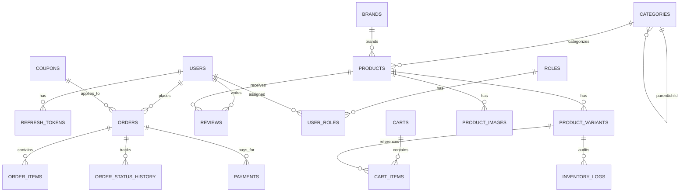

# ApexCommerce: Enterprise Clean Architecture E-Commerce Platform
## Master Architectural Blueprint & Implementation Plan
> **Target Audience**: Senior Laravel / Enterprise Backend Engineers transitioning to modern ASP.NET Core (.NET 9/10).  
> **Purpose**: A production-grade, portfolio-ready E-Commerce system showcasing Clean Architecture, Domain-Driven Design (DDD), CQRS, PostgreSQL, Redis, and Dual API Suites (Storefront + Admin Dashboard).

---

## 1. Executive Summary & Project Scope

**ApexCommerce** is designed as a complete, real-world E-Commerce platform capable of serving as both a production backend and an elite engineering portfolio demonstration.

Just like an enterprise Laravel setup that powers both a public customer storefront and a rich administrative back-office (e.g., Filament / Nova), ApexCommerce provides two distinct API realms over a single unified, clean domain:

```
                              ┌───────────────────────────────────┐
                              │     ApexCommerce Unified Host     │
                              │           (ASP.NET Core)          │
                              └─────────────────┬─────────────────┘
                                                │
                       ┌────────────────────────┴────────────────────────┐
                       ▼                                                 ▼
        ┌─────────────────────────────┐                   ┌─────────────────────────────┐
        │     Storefront API Suite    │                   │   Admin Dashboard API Suite │
        │     (/api/v1/store/...)     │                   │     (/api/v1/admin/...)     │
        ├─────────────────────────────┤                   ├─────────────────────────────┤
        │ • Customer Registration/Auth│                   │ • Real-time Sales Analytics │
        │ • Catalog Browsing & Search │                   │ • Revenue & Profit Metrics  │
        │ • Product Variants & Pricing│                   │ • Catalog & Stock Manager   │
        │ • Session/Customer Cart     │                   │ • Order Processing Workflow │
        │ • Multi-step Checkout       │                   │ • Inventory Audit & Alerts  │
        │ • Payment Processing (Stripe│                   │ • Customer Management & LTV │
        │ • Order History & Tracking  │                   │ • Promo & Coupon Engine     │
        │ • Verified Product Reviews  │                   │ • Role-Based Access Control │
        └─────────────────────────────┘                   └─────────────────────────────┘
```

---

## 2. Laravel vs .NET Architectural Parallelism

To ensure rapid comprehension for senior Laravel developers, every subsystem maps to its direct Laravel equivalent:

| Feature Area | Laravel Enterprise Paradigm | ApexCommerce (.NET 9/10 Paradigm) |
| :--- | :--- | :--- |
| **Architectural Style** | Monolithic MVC / Modular Actions | Clean Architecture (Domain, Application, Infrastructure, API) |
| **Admin Back-Office** | Laravel Filament / Nova / Custom Blade | Admin API Suite + CQRS Analytics Queries + RBAC Policies |
| **Authentication & Tokens**| Laravel Sanctum / Passport (Bearer Token) | ASP.NET Core JWT Bearer + Refresh Token Rotation in Database |
| **Permissions & Roles** | Spatie Laravel-Permission (`can:orders.view`) | Claims-Based Authorization & Custom Policies (`[Authorize(Policy = "...")]`) |
| **ORM & Data Access** | Eloquent (Active Record: Model has DB methods) | EF Core (Data Mapper: POCO Entities + DbContext Unit of Work) |
| **Database Migrations** | `database/migrations` + `php artisan migrate` | EF Core Fluent API Configurations + Code-First Migrations |
| **Database Seeding** | `DatabaseSeeder.php` + Model Factories | `DbInitializer.cs` with idempotent sample data generation |
| **Validation** | FormRequests (`StoreOrderRequest::rules()`) | FluentValidation (`AbstractValidator<TCommand>`) + MediatR Pipeline |
| **Business Logic** | Single Action Classes (`app/Actions`) | CQRS Command Handlers (`IRequestHandler<TCommand, TResult>`) |
| **Read Operations** | Eloquent Scopes + API Resources | CQRS Query Handlers + DTO Projections with Redis Cache-Aside |
| **Async Queues & Workers**| `dispatch(new Job)` + `php artisan queue:work` | High-throughput `System.Threading.Channels` + `BackgroundService` Worker |
| **Domain Events** | `event(new OrderCreated($order))` | `AggregateRoot.RaiseDomainEvent()` dispatched atomically post-commit |
| **Event Listeners** | `app/Listeners/SendEmailNotification.php` | MediatR Notification Handlers (`INotificationHandler<TDomainEvent>`) |
| **Caching Strategy** | `Cache::remember('key', $ttl, ...)` | Redis Distributed Cache (`IDistributedCache`) + Cache Invalidation Hooks |
| **Error Format** | Custom JSON in `bootstrap/app.php` | RFC 7807 Standard `ProblemDetails` & `ValidationProblemDetails` |

---

## 3. Core Domain Entities & Database Schema

The database model is designed using strict Domain-Driven Design (DDD) principles:



### Key Domain Models:
1. **Identity & Security**:
   - `User`: Guid Id, Email, PasswordHash, FirstName, LastName, PhoneNumber, IsActive, CreatedAtUtc.
   - `Role`: SuperAdmin, Admin, StoreManager, Customer.
   - `RefreshToken`: Token, ExpiryDate, IsRevoked, ReplacedByToken.
2. **Catalog & Inventory**:
   - `Category`: Id, Name, Slug, Description, ParentCategoryId (self-referencing tree), DisplayOrder, IsActive.
   - `Brand`: Id, Name, Slug, LogoUrl, Website.
   - `Product` (Aggregate Root): Id, Name, Slug, ShortDescription, Description, BrandId, CategoryId, BasePrice, IsActive, Featured.
   - `ProductVariant`: Id, ProductId, Sku, Barcode, VariantName (e.g. "Midnight Blue / XL"), AdditionalPrice, AvailableStock, ReservedStock, LowStockThreshold.
   - `ProductImage`: Id, ProductId, ImageUrl, AltText, IsPrimary, DisplayOrder.
   - `InventoryLog`: Id, VariantId, QuantityDelta, Reason (OrderReservation, Restock, OrderCancelled, Damaged), CreatedAtUtc.
3. **Cart & Shopping Experience**:
   - `Cart` (Aggregate Root): Id, CustomerId (nullable for guests), SessionId (for guests), ExpiresAtUtc.
   - `CartItem`: Id, CartId, VariantId, Quantity, UnitPriceAtAddition.
4. **Order & Fulfillment**:
   - `Order` (Aggregate Root): Id, OrderNumber (e.g. `APX-2026-00101`), CustomerId, OrderStatus (`PendingPayment`, `Processing`, `Shipped`, `Delivered`, `Cancelled`), PaymentStatus (`Unpaid`, `Paid`, `Refunded`), SubTotal, DiscountAmount, TaxAmount, ShippingCost, TotalAmount, CouponCode.
   - `OrderItem`: Id, OrderId, ProductVariantId, ProductName, Sku, UnitPrice, Quantity, TotalPrice.
   - `Address` (Value Object): Street, City, State, PostalCode, Country.
   - `OrderStatusHistory`: Id, OrderId, FromStatus, ToStatus, Comment, CreatedBy, CreatedAtUtc.
5. **Billing & Discounts**:
   - `Payment`: Id, OrderId, Provider (Stripe, SSLCommerz, COD), TransactionId, Amount, Currency, Status, PayloadJson.
   - `Coupon`: Id, Code, DiscountType (Percentage vs FixedAmount), DiscountValue, MinOrderAmount, MaxDiscountAmount, StartDateUtc, ExpiryDateUtc, MaxUsageCount, UsedCount, IsActive.
   - `Review`: Id, ProductId, CustomerId, Rating (1-5), Title, Comment, IsVerifiedPurchase, CreatedAtUtc.

---

## 4. API Endpoint Specifications

The application hosts two structured OpenAPI/Swagger feature groups:

### 4.1 Storefront Client API (`/api/v1/store`)
| Method | Endpoint | Auth | Purpose |
| :--- | :--- | :--- | :--- |
| `POST` | `/api/v1/auth/register` | Public | Customer registration with auto-login |
| `POST` | `/api/v1/auth/login` | Public | Obtain JWT Access Token + Refresh Token |
| `POST` | `/api/v1/auth/refresh-token` | Public | Rotate refresh token and issue new JWT |
| `GET`  | `/api/v1/store/products` | Public | Paginated catalog with filters (category, brand, price, sorting) |
| `GET`  | `/api/v1/store/products/{slug}` | Public | Detailed product view with active variants & reviews |
| `GET`  | `/api/v1/store/categories` | Public | Full category hierarchy tree |
| `GET`  | `/api/v1/store/cart` | Guest/User | Retrieve current active cart |
| `POST` | `/api/v1/store/cart/items` | Guest/User | Add variant item to cart with stock validation |
| `PUT`  | `/api/v1/store/cart/items/{id}`| Guest/User | Update cart item quantity |
| `DELETE`| `/api/v1/store/cart/items/{id}`| Guest/User | Remove item from cart |
| `POST` | `/api/v1/store/cart/apply-coupon`| Guest/User | Validate and apply promo code |
| `POST` | `/api/v1/store/checkout` | Customer | Convert cart into Order, reserve stock, generate payment intent |
| `GET`  | `/api/v1/store/orders` | Customer | Order history for logged-in customer |
| `GET`  | `/api/v1/store/orders/{id}` | Customer | Detailed order timeline & item status |
| `POST` | `/api/v1/store/orders/{id}/cancel` | Customer | Cancel unfulfilled order and release inventory |
| `POST` | `/api/v1/store/payments/webhook` | Webhook | Idempotent payment gateway webhook (e.g., Stripe) |
| `POST` | `/api/v1/store/products/{id}/reviews`| Customer | Submit review (verifies prior purchase) |

### 4.2 Admin Back-Office API (`/api/v1/admin`)
| Method | Endpoint | Policy / Role | Purpose |
| :--- | :--- | :--- | :--- |
| `GET`  | `/api/v1/admin/analytics/overview` | Admin/Manager | Top KPIs: Gross Revenue, Today's Orders, Low Stock Count, AOV |
| `GET`  | `/api/v1/admin/analytics/sales-chart`| Admin/Manager | Daily / Monthly revenue trend for chart rendering |
| `GET`  | `/api/v1/admin/analytics/top-products`| Admin/Manager | Best-selling products by quantity and revenue |
| `GET`  | `/api/v1/admin/products` | Admin/Manager | Admin product list with stock status, SKU, and price |
| `POST` | `/api/v1/admin/products` | Admin/Manager | Create product with variants, attributes, and image gallery |
| `PUT`  | `/api/v1/admin/products/{id}` | Admin/Manager | Update product details and pricing |
| `DELETE`| `/api/v1/admin/products/{id}` | SuperAdmin | Soft-delete / deactivate product |
| `POST` | `/api/v1/admin/products/{id}/variants` | Admin/Manager | Add or update variant SKUs and stock |
| `GET`  | `/api/v1/admin/categories` | Admin/Manager | Manage categories (create, edit, re-order tree) |
| `GET`  | `/api/v1/admin/orders` | Admin/Manager | Filterable order management table with status tags |
| `GET`  | `/api/v1/admin/orders/{id}` | Admin/Manager | Full order inspector: items, payment log, customer history |
| `PUT`  | `/api/v1/admin/orders/{id}/status` | Admin/Manager | Update fulfillment state (`Processing` -> `Shipped` with tracking) |
| `POST` | `/api/v1/admin/orders/{id}/refund` | SuperAdmin | Issue full or partial refund and restock items |
| `GET`  | `/api/v1/admin/inventory/low-stock` | Admin/Manager | Products below safety stock threshold |
| `POST` | `/api/v1/admin/inventory/adjust` | Admin/Manager | Manual stock restock or damage write-off with audit log |
| `GET`  | `/api/v1/admin/customers` | Admin/Manager | Customer roster with order count and Lifetime Value (LTV) |
| `PUT`  | `/api/v1/admin/customers/{id}/status` | SuperAdmin | Block / unblock fraudulent accounts |
| `GET`  | `/api/v1/admin/coupons` | Admin/Manager | Manage active promotional discount codes |

---

## 5. Clean Architecture Layer Distribution

```
ApexCommerce/
├── ApexCommerce.slnx
├── docker-compose.yml
├── Dockerfile
│
├── src/
│   ├── ApexCommerce.Domain/
│   │   ├── Common/              # Entity, AggregateRoot, ValueObject, IDomainEvent
│   │   ├── Entities/            # Product, ProductVariant, Order, Cart, Customer, Coupon, Review
│   │   ├── ValueObjects/        # Money, Sku, Address
│   │   ├── Enums/               # OrderStatus, PaymentStatus, DiscountType
│   │   ├── Events/              # OrderPlacedEvent, StockDepletedEvent, PaymentCompletedEvent
│   │   └── Exceptions/          # DomainRuleException, InsufficientStockException
│   │
│   ├── ApexCommerce.Application/
│   │   ├── Common/
│   │   │   ├── Behaviors/       # ValidationBehavior, LoggingBehavior, PerformanceBehavior
│   │   │   ├── DTOs/            # Storefront DTOs, Admin DTOs, Analytics DTOs
│   │   │   ├── Interfaces/      # IApplicationDbContext, ICacheService, ICurrentUserService, IBackgroundTaskQueue
│   │   │   └── Models/          # PaginatedList<T>, Result<T>
│   │   └── Features/
│   │       ├── Admin/           # Admin CQRS Features (Analytics, ProductOps, OrderOps, InventoryOps)
│   │       └── Store/           # Storefront CQRS Features (Catalog, Cart, Checkout, CustomerOrders)
│   │
│   ├── ApexCommerce.Infrastructure/
│   │   ├── Persistence/
│   │   │   ├── ApplicationDbContext.cs
│   │   │   ├── Configurations/  # EF Core Fluent API Schema configurations
│   │   │   ├── Migrations/      # Code-First Migrations
│   │   │   └── DbInitializer.cs # Rich sample data seeder
│   │   ├── Identity/            # JWT Token Generator, Password Hasher, CurrentUser Provider
│   │   ├── Caching/             # Redis Cache Service with key tagging & eviction
│   │   ├── BackgroundJobs/      # Channel-based async task queue & worker
│   │   └── Payments/            # Mock & Stripe payment gateway adapters
│   │
│   └── ApexCommerce.Api/
│       ├── Controllers/
│       │   ├── Store/           # Storefront Controllers (Products, Cart, Checkout, Orders, Reviews)
│       │   └── Admin/           # Admin Controllers (Analytics, Products, Orders, Inventory, Customers)
│       ├── Middleware/          # RFC 7807 Exception Middleware, Request Logging
│       ├── Extensions/          # Swagger dual-grouping, JWT configuration, CORS
│       └── Program.cs           # Kestrel HTTP pipeline configuration
│
└── tests/
    ├── ApexCommerce.Domain.UnitTests/      # Pure domain rules & aggregate invariants
    ├── ApexCommerce.Application.UnitTests/ # CQRS Handlers & FluentValidators with NSubstitute
    └── ApexCommerce.IntegrationTests/      # End-to-end API tests with WebApplicationFactory
```

---

## 6. Phase-by-Phase Implementation Roadmap

### Phase 1: Solution Scaffolding & Domain Core
- Create Solution and 4 Clean Architecture projects + Test projects.
- Implement pure domain entities: `Product`, `ProductVariant`, `Category`, `Brand`, `Cart`, `Order`, `OrderItem`, `Coupon`, `Review`.
- Value Objects: `Money` (Currency + Amount), `Address`, `Sku`.
- Domain Events: `OrderCreatedDomainEvent`, `StockReservedDomainEvent`.

### Phase 2: Persistence & Infrastructure
- Configure EF Core with PostgreSQL and write Fluent API entity configurations.
- Implement `ApplicationDbContext` (Unit of Work + Domain Event Dispatcher).
- Add Redis Caching Service with Cache-Aside pattern.
- Implement Channel-based Background Task Queue & Hosted Service worker.
- Write `DbInitializer` with rich, realistic e-commerce seed data (Electronics, Apparel, Customers, Admin).

### Phase 3: Application CQRS (Storefront Suite)
- Commands: `AddToCartCommand`, `UpdateCartItemCommand`, `ApplyCouponCommand`, `CheckoutOrderCommand`.
- Queries: `GetProductsQuery` (with Redis cache & filters), `GetProductBySlugQuery`, `GetCustomerOrdersQuery`.
- Validators: FluentValidation rules for checkout, addresses, and cart limits.
- Domain Event Handlers: Invalidate product cache upon stock reservation; dispatch confirmation email.

### Phase 4: Application CQRS (Admin Back-Office Suite)
- Analytics Queries: `GetDashboardOverviewQuery` (Gross Revenue, Orders Today, Low Stock Items, AOV).
- Catalog Commands: `CreateProductCommand`, `UpdateProductCommand`, `AdjustStockCommand`.
- Order Management: `UpdateOrderStatusCommand` (Fulfillment transitions with tracking), `RefundOrderCommand`.
- RBAC Enforcement: Role policies (`AdminOnly`, `ManagerOrAdmin`).

### Phase 5: API Presentation Layer & Dual Swagger UI
- Build Storefront Controllers (`/api/v1/store/...`).
- Build Admin Controllers (`/api/v1/admin/...`).
- Configure Swagger OpenAPI with two distinct documents (Storefront vs Admin).
- Configure RFC 7807 Global Exception Handling Middleware.
- Configure JWT Bearer Authentication and Refresh Token exchange.

### Phase 6: Automated Testing, Docker & Verification
- Domain unit tests for order lifecycle, stock reservation, and coupon calculations.
- Application handler unit tests using NSubstitute.
- Complete `docker-compose.yml` (PostgreSQL 16, Redis 7, ApexCommerce API).
- Production-ready documentation and cURL walkthrough.

---

## 7. Immediate Next Step & Decision Point

The complete plan is safely stored at:
[`c:\Users\Dell\Herd\ApexCommerce\PLAN.md`](file:///c:/Users/Dell/Herd/ApexCommerce/PLAN.md)

**Please review this plan. Upon your approval, we will proceed immediately with Phase 1 and build out the full platform step-by-step.**

