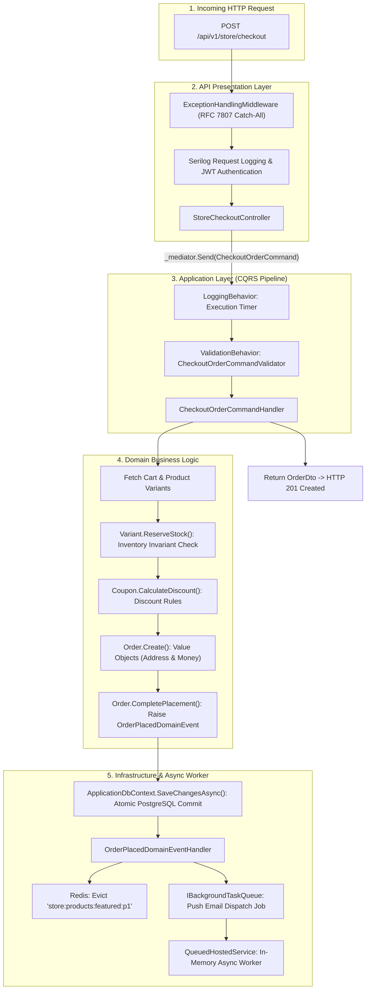

# ApexCommerce: Enterprise Clean Architecture E-Commerce Platform
### Dual API Suite (Storefront & Admin Dashboard) for High-Throughput E-Commerce

[](https://dotnet.microsoft.com/)
[](https://blog.cleancoder.com/uncle-bob/2012/08/13/the-clean-architecture.html)
[](https://www.postgresql.org/)
[](https://redis.io/)
[](https://www.docker.com/)
[](https://datatracker.ietf.org/doc/html/rfc7807)
[](LICENSE)

**ApexCommerce** is an enterprise-grade reference E-Commerce backend built with modern **ASP.NET Core (.NET 9/10)**, adhering to **Clean Architecture**, **Domain-Driven Design (DDD)**, and **CQRS (Command Query Responsibility Segregation)** with MediatR.

Designed specifically to power high-scale online storefronts alongside rich back-office management dashboards (similar to enterprise Laravel setups with custom SPAs or Filament/Nova), ApexCommerce separates concerns into two distinct API suites sharing a single, robust domain model.

---

## Table of Contents
- [1. Architectural Overview & Dual API Model](#1-architectural-overview--dual-api-model)
- [2. Laravel vs .NET Architectural Rosetta Stone](#2-laravel-vs-net-architectural-rosetta-stone)
- [3. Request Lifecycle Execution Diagram](#3-request-lifecycle-execution-diagram)
- [4. Project Solution Structure](#4-project-solution-structure)
- [5. API Endpoints Catalog](#5-api-endpoints-catalog)
- [6. Quick Start & Docker Deployment](#6-quick-start--docker-deployment)
- [7. Test Authentication & API Walkthrough](#7-test-authentication--api-walkthrough)
- [8. Core Domain Features & Invariants](#8-core-domain-features--invariants)
- [9. Automated Testing Strategy](#9-automated-testing-strategy)

---

## 1. Architectural Overview & Dual API Model

ApexCommerce is partitioned into two specialized OpenAPI / Swagger specifications:

```
                            ┌───────────────────────────────────┐
                            │     ApexCommerce Web Host         │
                            │        (ASP.NET Core Kestrel)     │
                            └─────────────────┬─────────────────┘
                                              │
                     ┌────────────────────────┴────────────────────────┐
                     ▼                                                 ▼
      ┌─────────────────────────────┐                   ┌─────────────────────────────┐
      │     Storefront API Suite    │                   │   Admin Dashboard API Suite │
      │     (/api/v1/store/...)     │                   │     (/api/v1/admin/...)     │
      ├─────────────────────────────┤                   ├─────────────────────────────┤
      │ • Customer Registration/Auth│                   │ • Real-time Sales Analytics │
      │ • Catalog Search & Filtering│                   │ • Revenue & AOV KPI Metrics │
      │ • Product Variants & Pricing│                   │ • Catalog CRUD & Taxonomies │
      │ • Session / Customer Cart   │                   │ • Order Fulfillment Flow    │
      │ • Multi-step Checkout       │                   │ • Stock Restock & Damage Log│
      │ • Stock Reservation System  │                   │ • Low-Stock Warning Radar   │
      │ • Coupon & Promo Engine     │                   │ • Customer Management & LTV │
      │ • Customer Order Tracking   │                   │ • Role-Based Access Control │
      └─────────────────────────────┘                   └─────────────────────────────┘
```

---

## 2. Laravel vs .NET Architectural Rosetta Stone

For experienced **PHP/Laravel developers**, every component in ApexCommerce maps directly to its Laravel idiom:

| Architecture Concern | Laravel Enterprise Pattern | ApexCommerce (.NET 9/10 Pattern) | Implementation Location |
| :--- | :--- | :--- | :--- |
| **Admin Back-Office** | Laravel Filament / Nova / Custom SPA | Admin API Suite + CQRS Analytics Queries + RBAC | [`AdminAnalyticsController.cs`](src/ApexCommerce.Api/Controllers/Admin/AdminAnalyticsAndInventoryControllers.cs) |
| **Authentication** | Laravel Sanctum / Passport (Bearer Token) | ASP.NET Core JWT Bearer + Refresh Token Rotation | [`AuthenticationExtensions.cs`](src/ApexCommerce.Api/Extensions/AuthenticationExtensions.cs) |
| **Authorization / RBAC**| Spatie Laravel-Permission (`can:orders.manage`)| Claims-based Custom Policies (`[Authorize(Policy = "...")]`)| [`AuthenticationExtensions.cs`](src/ApexCommerce.Api/Extensions/AuthenticationExtensions.cs) |
| **ORM & Data Access** | Eloquent (Active Record: DB logic in model) | EF Core (Data Mapper: POCO Entities + DbContext Unit of Work) | [`Product.cs`](src/ApexCommerce.Domain/Entities/Product.cs) |
| **Schema Configurations**| `database/migrations` + `Schema::create` | EF Core Fluent API Configurations (`IEntityTypeConfiguration<T>`)| [`CartAndOrderConfigurations.cs`](src/ApexCommerce.Infrastructure/Persistence/Configurations/CartAndOrderConfigurations.cs) |
| **Request Validation** | FormRequests (`StoreOrderRequest::rules()`) | FluentValidation (`AbstractValidator<TCommand>`) | [`CheckoutOrderCommand.cs`](src/ApexCommerce.Application/Features/Store/Checkout/Commands/CheckoutOrder/CheckoutOrderCommand.cs) |
| **Validation Pipeline** | Automatic validation prior to Controller | MediatR Pipeline Behavior (`ValidationBehavior`) | [`PipelineBehaviors.cs`](src/ApexCommerce.Application/Common/Behaviors/PipelineBehaviors.cs) |
| **Business Actions** | Single Action Classes (`app/Actions`) | CQRS Command Handlers (`IRequestHandler<TCommand, TResult>`) | [`CheckoutOrderCommandHandler`](src/ApexCommerce.Application/Features/Store/Checkout/Commands/CheckoutOrder/CheckoutOrderCommand.cs) |
| **Read Operations** | Eloquent Query Scopes + API Resources | CQRS Query Handlers + C# Record DTOs + Redis Cache-Aside | [`GetProductsQuery.cs`](src/ApexCommerce.Application/Features/Store/Catalog/Queries/GetProducts/GetProductsQuery.cs) |
| **Queues & Workers** | `dispatch(new Job)` + `php artisan queue:work` | `System.Threading.Channels` + `BackgroundService` Hosted Worker | [`BackgroundJobServices.cs`](src/ApexCommerce.Infrastructure/BackgroundJobs/BackgroundJobServices.cs) |
| **Domain Events** | `event(new OrderCreated($order))` | `AggregateRoot.RaiseDomainEvent()` dispatched atomically post-commit| [`DomainEvents.cs`](src/ApexCommerce.Domain/Events/DomainEvents.cs) |
| **Event Listeners** | `app/Listeners/SendEmailNotification.php` | MediatR Notification Handlers (`INotificationHandler<TEvent>`) | [`OrderPlacedDomainEventHandler.cs`](src/ApexCommerce.Application/Features/Store/Orders/Events/OrderPlacedDomainEventHandler.cs) |
| **Caching Strategy** | `Cache::remember('key', $ttl, ...)` | Redis Distributed Cache (`IDistributedCache`) + Event-driven Eviction| [`DistributedCacheService.cs`](src/ApexCommerce.Infrastructure/Caching/DistributedCacheService.cs) |
| **Standardized Errors** | Custom JSON in `bootstrap/app.php` | RFC 7807 Standard `ProblemDetails` & `ValidationProblemDetails` | [`ExceptionHandlingMiddleware.cs`](src/ApexCommerce.Api/Middleware/ExceptionHandlingMiddleware.cs) |

---

## 3. Request Lifecycle Execution Diagram



---

## 4. Project Solution Structure

```
ApexCommerce/
├── ApexCommerce.slnx               # Modern XML Solution format
├── docker-compose.yml              # Multi-container stack (Postgres + Redis + API)
├── Dockerfile                      # Optimized production container build
│
├── src/
│   ├── ApexCommerce.Domain/        # CORE BUSINESS LOGIC (Zero external dependencies)
│   │   ├── Common/                 # Entity, AggregateRoot, ValueObject, IDomainEvent
│   │   ├── Entities/               # User, Product, ProductVariant, Cart, Order, Coupon, Review, InventoryLog
│   │   ├── ValueObjects/           # Money, Address, Sku
│   │   ├── Enums/                  # OrderStatus, PaymentStatus, UserRole, InventoryChangeReason
│   │   ├── Events/                 # OrderPlacedDomainEvent, OrderCancelledDomainEvent
│   │   ├── Exceptions/             # InsufficientStockException, CouponNotApplicableException
│   │   └── Repositories/           # Pure interfaces: IProductRepository, IOrderRepository, IUnitOfWork
│   │
│   ├── ApexCommerce.Application/   # APPLICATION LOGIC & USE CASES (CQRS)
│   │   ├── Common/                 # Pipeline Behaviors (Logging, Validation, Performance), DTOs, Interfaces
│   │   └── Features/
│   │       ├── Auth/               # Register, Login, RefreshToken
│   │       ├── Store/              # Catalog Search, Cart, Checkout, Order Tracking, Reviews
│   │       └── Admin/              # Sales Analytics, Product CRUD, Order Fulfillment, Stock Adjustments
│   │
│   ├── ApexCommerce.Infrastructure/# EXTERNAL SYSTEMS & PERSISTENCE
│   │   ├── Persistence/            # ApplicationDbContext, EF Core Fluent API Configurations, DbInitializer
│   │   ├── Identity/               # JwtTokenGenerator, BCrypt PasswordHasher, CurrentUserService
│   │   ├── Caching/                # DistributedCacheService (StackExchange.Redis)
│   │   └── BackgroundJobs/         # Channel-based async queue & QueuedHostedService
│   │
│   ├── ApexCommerce.Admin.Blazor/  # BLAZOR INTERACTIVE SERVER ADMIN PANEL
│   │   ├── Pages/                  # Dashboard.razor, Orders.razor, Inventory.razor, Products.razor
│   │   ├── Layout/                 # MainLayout.razor, NavMenu.razor
│   │   └── wwwroot/css/            # admin.css (Tailwind-styled responsive CSS)
│   │
│   └── ApexCommerce.Api/           # PRESENTATION & HTTP HOSTING
│       ├── Controllers/            # Auth, Store (Catalog, Cart, Checkout), Admin (Analytics, Products, Orders)
│       ├── Middleware/             # ExceptionHandlingMiddleware (RFC 7807 problem details)
│       ├── Extensions/             # Swagger dual-documentation setup, JWT policy configuration
│       └── Program.cs              # Web pipeline & dependency injection configuration
│
└── tests/
    ├── ApexCommerce.Domain.UnitTests/      # Unit tests for aggregates, stock reservation & coupons
    └── ApexCommerce.Application.UnitTests/ # CQRS Handlers & Validators unit tests with NSubstitute
```

---

## 5. API Endpoints Catalog

### 5.1 Storefront Customer API (`/api/v1/store`)
| Verb | Endpoint | Access | Description |
| :--- | :--- | :--- | :--- |
| `POST` | `/api/v1/auth/register` | Public | Customer account registration |
| `POST` | `/api/v1/auth/login` | Public | Authenticate and obtain JWT + Refresh Token |
| `POST` | `/api/v1/auth/refresh-token` | Public | Exchange refresh token for fresh JWT |
| `GET`  | `/api/v1/auth/me` | Customer | Retrieve current authenticated user profile |
| `GET`  | `/api/v1/store/products` | Public | Search products with filtering (category, price range, brand) |
| `GET`  | `/api/v1/store/products/{slug}` | Public | Detailed product view with active variants & reviews |
| `GET`  | `/api/v1/store/categories` | Public | Category taxonomy tree (cached in Redis) |
| `GET`  | `/api/v1/store/cart` | Guest/User | Retrieve active shopping cart |
| `POST` | `/api/v1/store/cart/items` | Guest/User | Add item to cart with available stock validation |
| `PUT`  | `/api/v1/store/cart/items/{id}`| Guest/User | Update item quantity |
| `DELETE`| `/api/v1/store/cart/items/{id}`| Guest/User | Remove item from cart |
| `POST` | `/api/v1/store/cart/apply-coupon`| Guest/User | Validate and calculate coupon discount |
| `POST` | `/api/v1/store/checkout` | Customer | Reserve inventory, apply coupon, and place order |
| `GET`  | `/api/v1/store/orders` | Customer | Order history list for logged-in user |
| `GET`  | `/api/v1/store/orders/{id}` | Customer | Specific order details and items |
| `POST` | `/api/v1/store/orders/{id}/cancel` | Customer | Cancel unfulfilled order and release reserved stock |

### 5.2 Admin Back-Office API (`/api/v1/admin`)
| Verb | Endpoint | Policy | Description |
| :--- | :--- | :--- | :--- |
| `GET`  | `/api/v1/admin/analytics/overview` | ManagerOrAdmin | Executive KPIs: Gross Revenue, Orders Today, Low Stock, AOV |
| `GET`  | `/api/v1/admin/analytics/sales-chart`| ManagerOrAdmin | Daily revenue and orders count trend |
| `GET`  | `/api/v1/admin/inventory/low-stock` | ManagerOrAdmin | Radar for variants below low-stock threshold |
| `POST` | `/api/v1/admin/inventory/{id}/adjust`| ManagerOrAdmin | Manual inventory restock or write-off with audit log |
| `POST` | `/api/v1/admin/products` | ManagerOrAdmin | Create product with variants and pricing |
| `PUT`  | `/api/v1/admin/products/{id}` | ManagerOrAdmin | Update product details |
| `POST` | `/api/v1/admin/products/categories` | ManagerOrAdmin | Add new category taxonomy |
| `GET`  | `/api/v1/admin/orders` | ManagerOrAdmin | Order management table with status filtering |
| `PUT`  | `/api/v1/admin/orders/{id}/status` | ManagerOrAdmin | Update fulfillment state (`Shipped` with carrier and tracking) |
| `POST` | `/api/v1/admin/orders/{id}/refund` | AdminOnly | Process order refund and return items to inventory |
| `GET`  | `/api/v1/admin/customers` | ManagerOrAdmin | Customers roster with order count and Lifetime Value (LTV) |
| `PUT`  | `/api/v1/admin/customers/{id}/status`| AdminOnly | Block or unblock a customer account |

---

## 6. Quick Start & Docker Deployment

### Launch Complete Container Stack
Requires Docker Desktop:

```bash
docker compose up --build
```

- **Interactive Dual Swagger UI (API)**: [http://localhost:5000](http://localhost:5000)
- **Blazor Admin Control Center (Live UI)**: [http://localhost:5001](http://localhost:5001)
- **PostgreSQL Database**: `localhost:5432` (`apexcommerce_db`, user: `postgres`, password: `postgrespassword`)
- **Redis Cache**: `localhost:6379`

> Database migrations and realistic demo data (electronics, apparel, stock, admin & customer users) seed automatically upon startup.

---

## 7. Test Authentication & API Walkthrough

### Pre-Seeded Accounts:
- **SuperAdmin**: `admin@apexcommerce.com` / `AdminSecret123!`
- **Store Manager**: `manager@apexcommerce.com` / `ManagerSecret123!`
- **Customer**: `alex.engineer@enterprise.com` / `SecretPassword123!`

### 1. Authenticate (Obtain Token)
```bash
curl -X POST http://localhost:5000/api/v1/auth/login \
  -H "Content-Type: application/json" \
  -d '{
    "email": "alex.engineer@enterprise.com",
    "password": "SecretPassword123!"
  }'
```

### 2. Browse Product Catalog (Redis Cached)
```bash
curl -X GET "http://localhost:5000/api/v1/store/products?page=1&pageSize=10"
```

### 3. Add to Cart
```bash
curl -X POST http://localhost:5000/api/v1/store/cart/items \
  -H "Authorization: Bearer <TOKEN>" \
  -H "Content-Type: application/json" \
  -d '{
    "variantId": "40000000-0000-0000-0000-000000000001",
    "quantity": 1
  }'
```

### 4. Checkout Order (Stock Reservation + Background Job)
```bash
curl -X POST http://localhost:5000/api/v1/store/checkout \
  -H "Authorization: Bearer <TOKEN>" \
  -H "Content-Type: application/json" \
  -d '{
    "street": "123 Technology Way",
    "city": "Austin",
    "state": "TX",
    "postalCode": "78701",
    "country": "USA",
    "couponCode": "WELCOME10"
  }'
```

### 5. View Executive Admin Analytics (Switch to Admin Token)
```bash
curl -X GET http://localhost:5000/api/v1/admin/analytics/overview \
  -H "Authorization: Bearer <ADMIN_TOKEN>"
```

---

## 8. Core Domain Features & Invariants

1. **Inventory Guard & Optimistic Concurrency**:
   - `ProductVariant.ReserveStock()` strictly guarantees that orders cannot exceed physical inventory.
   - Database row versioning (`Version` token) prevents race conditions during high-volume flash sales.
2. **Channel-Based Background Workers**:
   - Instead of blocking HTTP threads, event side effects (such as email dispatch) are written into a high-throughput `System.Threading.Channels` queue and processed asynchronously by `QueuedHostedService`.
3. **Cache-Aside Pattern with Automatic Invalidation**:
   - Public product catalogs and categories are cached in Redis. Placing an order or restocking inventory raises domain events that instantly invalidate the affected cache keys.

---

## 9. Automated Testing Strategy

OrderPulse includes comprehensive automated tests:

```bash
dotnet test
```

- **Domain Tests (`tests/ApexCommerce.Domain.UnitTests`)**: Verifies aggregate invariants, stock reservation boundaries, and coupon calculation engines.
- **Application Tests (`tests/ApexCommerce.Application.UnitTests`)**: Tests CQRS command handlers with **NSubstitute** mocks and **FluentValidation** rule sets.

---

## License

This project is licensed under the MIT License. Developed as a production-grade Clean Architecture reference for enterprise software engineers.

# apex-commerce

